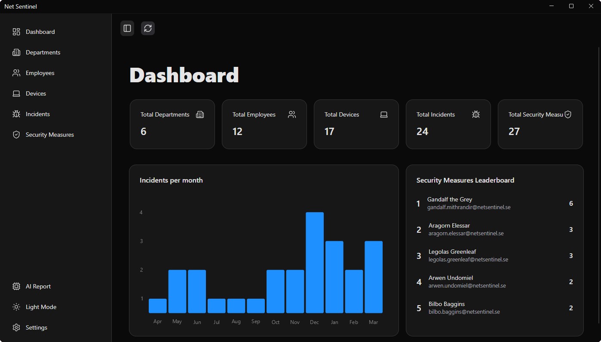

# Net Sentinel

A desktop app for an IT security team. It keeps track of departments, employees and their devices, logs security incidents and the measures taken against them, and can generate an AI report with prioritised recommendations based on the current incidents.

Built in **C# with Avalonia and Entity Framework Core** against an **Azure SQL** database, as a group project of four students in the Information Systems programme at Lund University (spring 2026).



## Features

- **Dashboard** with totals, a chart of incidents per month and a leaderboard of the employees who have carried out the most security measures.
- **Create, edit and delete** departments, employees, devices, incidents and security measures, in paginated tables with validated dialog forms.
- **Business rules** enforced both in the application and in the database (see below).
- **AI report** that sends the registered incidents to a language model and shows a summary and a prioritised list of actions for the IT team.
- Light and dark theme, toast notifications for errors, and a settings page for seeding and clearing test data.

## Tech stack

| Area | Technology |
|---|---|
| Language | C#, .NET 10 |
| UI | Avalonia 11, ShadUI, LiveCharts, Lucide icons |
| Architecture | MVVM (CommunityToolkit.Mvvm), dependency injection (Microsoft.Extensions.Hosting) |
| Data | Entity Framework Core 10 with code-first migrations, Azure SQL |
| AI | OpenAI-compatible chat completions API |

## Architecture

- **MVVM.** Views only bind to data. View models hold state and commands and know nothing about the views.
- **Services behind interfaces.** View models depend on `IIncidentService`, `IDeviceService` and so on, and get them through dependency injection. That keeps data access in one place and makes it easy to replace.
- **Short-lived database contexts.** Services create a `DbContext` per operation through `IDbContextFactory`, which suits a desktop app that stays open for a long time.
- **Navigation and dialogs** go through a `NavigationService` and a dialog manager registered in the DI container, so view models never create views themselves.

## Business rules

The rules come from the course's business case. They are enforced in `DatabaseContext.SaveChangesAsync`, which gives clear error messages in the UI, and backed by constraints in the database itself.

- A department can have at most 50 employees.
- An employee can own at most 3 devices.
- Incidents and security measures cannot be dated in the future (also a SQL check constraint).
- A department that still has employees, or a device that still has incidents, cannot be deleted. Deleting an employee keeps their devices and security measures but clears the link to them.
- Employees, incidents and security measures get readable sequential IDs (`EMP001`, `INC0001`, `SM0001`).

## AI-assisted reporting

The AI report collects every registered incident (description, device, priority, status and date), sends it to the model with a fixed prompt, and shows the answer: a short summary followed by numbered recommendations.

The report is decision support, not a decision. It is presented as recommendations for the IT team to review, and the app never changes any data based on the model's answer. Building it showed us where AI is genuinely useful, both in the development process and in the product, and why human review stays central.

## My contributions

- App shell: sidebar, navigation service with dependency injection, settings page and light/dark theme
- Dashboard: totals, incidents-per-month chart and leaderboard, with counts done in the database for speed
- Devices and security measures: tables, dialogs and validation
- Business rules and readable IDs in the data layer
- Reusable components: paginated data grid, priority and status badges, date and time picker
- Error handling with toast notifications, and seeding and clearing of test data
- Service interfaces and their registration across the app
- Improvements to the AI report and its layout

## What I learned

Turning a business case into working software: modelling employees, devices and security incidents as data, deciding which rules belong in the application and which in the database, and building a client on top of it in C# and Avalonia. Integrating the AI report gave practical insight into how AI can support both development and the finished product, and why it still needs human oversight.

## Running it locally

Requirements: [.NET 10 SDK](https://dotnet.microsoft.com/download) and an Azure SQL or SQL Server database.

1. Create `NetSentinel/appsettings.json` (the file is git-ignored):

   ```json
   {
     "ConnectionStrings": {
       "DefaultConnection": "<your SQL Server connection string>"
     },
     "ChatGpt": {
       "BaseUrl": "https://api.openai.com/v1",
       "ApiKey": "<your API key>"
     }
   }
   ```

   The `ChatGpt` section is only needed for the AI report. The rest of the app works without it.

2. Create the database schema:

   ```bash
   dotnet tool install --global dotnet-ef
   cd NetSentinel
   dotnet ef database update
   ```

3. Start the app from the repository root:

   ```bash
   dotnet run --project NetSentinel
   ```

4. Open **Settings** and seed the database with test data.
